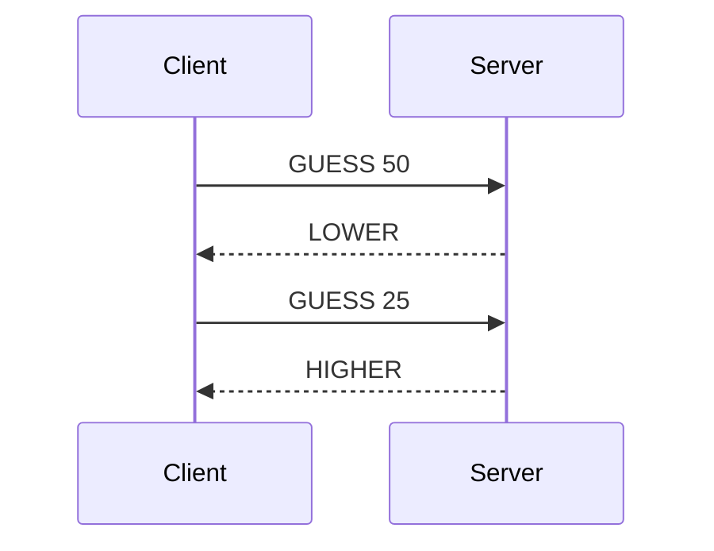

[Slides for this chapter](../slides/06-application-protocols.qmd)

## Objectives

By the end of this chapter, you should be able to:

- Explain what an application protocol is, and what it adds on top of
  TCP or UDP.
- Find the specification of an Internet protocol, and read the parts
  you need.
- List the decisions a protocol specification has to make: transport,
  port, encoding, framing, messages, order, errors.
- Write the specification of a simple text protocol, with sequence
  diagrams, that someone else can implement without asking you
  questions.

This chapter is short, and it is one of the most important of the
course: in [practical work 2](../practical-work/pw2.qmd) you design your
own protocol before you implement it, and the specification is part of
what is graded.

## What an application protocol is

Your mail program and Google's mail servers were written by different
people, in different languages, years apart. They still work together,
because both follow the same rules: the **SMTP protocol**. An
**application protocol** is that set of rules. It says:

- which **messages** the two programs can send each other, and what
  each one means;
- the **format** of each message, down to the bytes;
- in which **order** messages may be sent, and who speaks first;
- what happens on an **error**: an unknown message, a missing
  parameter, a request that comes at the wrong time.

An application protocol sits on top of the layers you saw in the
networking course:

| Layer | Examples | What it takes care of |
|---|---|---|
| Application | SMTP, HTTP, SSH, your own | What the bytes mean |
| Transport | TCP, UDP | Carrying bytes between **programs** |
| Network | IP | Carrying packets between two **machines** |

The transport layer gives you a way to move bytes, and nothing about
what they mean:

- **TCP** is a connection that carries a **stream of bytes**, reliably
  and in order. It knows nothing about messages: if the client sends
  two messages, the server may read them in one piece, or one message
  in several pieces. Remember from [chapter 04](04-java-io.qmd) that a
  short read does not mean the end of the stream.
- **UDP** carries **datagrams**: independent packets, each one
  delivered whole, but which can be lost, duplicated or arrive out of order.

Everything else is up to the application protocol, and therefore up to
you when you design one.

## Three families of protocols

| Family | Messages are | Examples | In this course |
|---|---|---|---|
| Text protocols | Lines of text, or text formats such as JSON | SMTP, POP3, IMAP, HTTP/1.1 | This chapter, SMTP, PW2 |
| Protocols on top of HTTP | HTTP requests to resources (`GET /users/42`) | Most web and mobile APIs (REST) | HTTP chapter, PW3 |
| Binary protocols | Fields of fixed or encoded size, in bytes | SSH, DNS, HTTP/2 and HTTP/3 | Read only |

A format is not a protocol: JSON says how one message is written, not
which messages exist, in which order, nor where one ends. A protocol
that carries JSON over TCP still answers those questions, one JSON
object per line for example.

The second family is not a third syntax: it reuses HTTP instead of
inventing its own messages, whatever version of HTTP carries them.

A **text protocol** can be read and typed by a human: you will talk to
an SMTP server by hand in the next chapter. That makes it easy to learn,
to debug and to test. A **binary protocol** is more compact and faster
to parse, but you need a tool to read it. HTTP shows both: HTTP/1.1 is
text, HTTP/2 and HTTP/3 carry the same requests in a binary format.

## Where specifications live: RFCs

The protocols of the Internet are specified by the
[IETF](https://www.ietf.org/) (Internet Engineering Task Force) in
documents called **RFC**, for *Request for Comments*. The name comes
from their origin: proposals open to comments. Today a protocol is
discussed as an *Internet-Draft*, revised as many times as needed, then
published as an RFC with a number.

A published RFC **never changes**. A new version of a protocol is a new
RFC, which *obsoletes* or *updates* the previous one: IMAP version 4rev1
was RFC 3501, IMAP4rev2 is RFC 9051. Each RFC also has a **status**:
Internet Standard, Proposed Standard, Informational, and others. Not
every RFC is a standard.

| Protocol | RFC |
|---|---|
| SMTP (sending mail) | [RFC 5321](https://www.rfc-editor.org/rfc/rfc5321) |
| POP3 (reading mail) | [RFC 1939](https://www.rfc-editor.org/rfc/rfc1939) |
| IMAP (reading mail) | [RFC 9051](https://www.rfc-editor.org/rfc/rfc9051) |
| SSH, transport layer | [RFC 4253](https://www.rfc-editor.org/rfc/rfc4253) |
| HTTP semantics, common to all versions | [RFC 9110](https://www.rfc-editor.org/rfc/rfc9110) |
| HTTP/1.1, HTTP/2, HTTP/3 | [RFC 9112](https://www.rfc-editor.org/rfc/rfc9112), [RFC 9113](https://www.rfc-editor.org/rfc/rfc9113), [RFC 9114](https://www.rfc-editor.org/rfc/rfc9114) |

Look up an RFC on the [IETF Datatracker](https://datatracker.ietf.org/):
the page of each RFC (`datatracker.ietf.org/doc/rfc3501`) shows its
status, and which RFCs obsolete or update it. RFCs are long: SMTP's has
95 pages. Do not read them from start to
end. Start with the examples (SMTP has a whole appendix of scenarios,
Appendix D), then look up the messages you need.

Port numbers are managed by the [IANA](https://www.iana.org/), in the
[port number
registry](https://www.iana.org/assignments/service-names-port-numbers/service-names-port-numbers.xhtml):
SMTP has port 25, HTTP port 80, SSH port 22.

## Anatomy of a real protocol

Here is a typical SMTP exchange, copied from Appendix D of RFC 5321.
`C:` is the client, `S:` the server:

```text
S: 220 foo.com Simple Mail Transfer Service Ready
C: EHLO bar.com
S: 250-foo.com greets bar.com
S: 250-8BITMIME
S: 250-SIZE
S: 250-DSN
S: 250 HELP
C: MAIL FROM:<Smith@bar.com>
S: 250 OK
C: RCPT TO:<Jones@foo.com>
S: 250 OK
C: RCPT TO:<Green@foo.com>
S: 550 No such user here
C: RCPT TO:<Brown@foo.com>
S: 250 OK
C: DATA
S: 354 Start mail input; end with <CRLF>.<CRLF>
C: Blah blah blah...
C: ...etc. etc. etc.
C: .
S: 250 OK
C: QUIT
S: 221 foo.com Service closing transmission channel
```

Everything a protocol has to define is in these few lines:

- **Who speaks first**: the server, with its `220` greeting. The client
  waits for it.
- **Messages**: the client sends **commands**, a keyword followed by
  parameters (`MAIL FROM:<Smith@bar.com>`). The RFC gives the exact
  syntax of each one.
- **Framing**: every line ends with `CR LF` (bytes `\r\n`). The text of
  the mail, which has several lines, ends with a line holding a single
  `.`.
- **Responses**: the server answers every command with a **three-digit
  code** and a text. The program reads the code (`250` success, `550`
  failure), the human reads the text. A reply can take several lines:
  all but the last carry a `-` after the code (`250-`), the last one a
  space (`250 `). That is how the client knows the reply is finished.
- **Order**: `MAIL` before `RCPT`, `RCPT` before `DATA`. A command in
  the wrong place gets an error code.
- **Errors**: Green has no mailbox; the server says so for that
  recipient, and the transaction goes on for the others.
- **Extensions**: the answer to `EHLO` lists the extensions this server
  supports (`8BITMIME`, `SIZE`, ...). A client uses an extension only if
  the server lists it.
- **End**: `QUIT`, then the server closes the connection.

## The decisions you make

When you design a protocol, nothing is decided for you. A specification
answers each of these questions explicitly. Each answer you leave out
becomes a guess in someone else's code, and two people guess
differently.

### Transport: TCP or UDP

TCP when every message matters and arrives in order: a chat, a
turn-based game, a file transfer. UDP when a lost message does no harm, or when the
application handles losses itself: a sensor that sends a measure every
minute, a discovery broadcast. With UDP, the specification says what
happens when a message is lost (retry after a timeout, or nothing).

You will program both in the TCP & UDP chapters; for now, choose and
justify.

### Port

The server listens on a port, and the client must know it: the
specification gives the number. IANA divides ports in three ranges
([RFC 6335](https://www.rfc-editor.org/rfc/rfc6335)):

| Range | Name | Use |
|---|---|---|
| 0-1023 | System ports (well-known) | Standard services; on Linux, by default, a program needs special rights to listen on them |
| 1024-49151 | User ports (registered) | Assigned to applications by IANA, on request |
| 49152-65535 | Dynamic ports | Never assigned, free for temporary use: macOS and Windows take the ports of clients from here (Linux from 32768-60999) |

For your own protocol, choose a port between 1024 and 32767 that is
unassigned in the IANA registry, and write it in the specification.
Above 32768, a Linux client may already have taken the port as a
temporary one, and your server fails to start with "Address already in
use".

### Who speaks first, who closes

The client is the side that opens the TCP connection; then either side
can send the first message: the server in SMTP (its greeting), the client in
HTTP (its request). Say which. Say also who closes the connection, and
when: after a `QUIT` message, after the server's answer, or when the
client decides to leave.

### Encoding

Text is bytes in an encoding ([chapter 04](04-java-io.qmd)). Write it
in the specification: **UTF-8**. Then any limit on the length of a text
must say what it counts: 100 characters in UTF-8 can take up to 400
bytes.

### Framing: where a message ends

On TCP, the receiver sees a stream of bytes. The protocol must tell it
where one message ends and the next one starts. There are three common
ways:

| Framing | How | Examples |
|---|---|---|
| **Delimiter** | Each message ends with a chosen character, often a newline | SMTP (`\r\n`), your PW2 protocol |
| **Length prefix** | The message starts with its length | The body of an HTTP/1.1 message (`Content-Length` header), most binary protocols |
| **Connection close** | The message ends when the sender closes the connection | Daytime ([exercise 1](#sec-ex1)) |

A delimiter is the simplest for a text protocol. It has one
consequence: the delimiter cannot appear **inside** a message. If a
chat message may contain a newline, the protocol must escape it, or
forbid it. SMTP has the same problem with the line that holds a single
`.`, and solves it by doubling a `.` at the start of any line of text
(section 4.5.2 of RFC 5321).

With UDP, each datagram is one message, so the framing is given, as
long as every message fits in one datagram. The specification therefore
gives a maximum size, and the receiver's buffer must be at least that
big.

### Message format

A simple and robust format for a text protocol, close to the commands
of SMTP and POP3, and used by all the examples of this chapter: one
message per line, a **keyword**
in capitals, then the parameters separated by a space.

```text
SEND bob Hello Bob!
```

A parameter that may contain spaces, such as the text of a message,
goes **last**: for `SEND`, the receiver splits the line on its first
two spaces, and everything after them is the text.

### Errors

For each message, list every possible response, the errors included.
Then answer the cases that are not tied to one message:

- an **unknown** message, or one with missing or invalid parameters;
- a valid message at the **wrong time** (`SEND` before `JOIN`);
- a client that disappears without saying goodbye.

Give each error a **code** that a program can test, as SMTP does, and
list the codes with their meaning. A code keeps the same meaning in the
whole protocol, like SMTP's `550`. Numbered per command, the code alone
no longer says what went wrong: the reader also has to know which
request it answers.

### Extensibility

A protocol lives longer than its first version. Three habits make it
possible to extend it later without breaking the programs that already
exist:

- A new version **adds** messages, and keeps the existing ones as they
  are: same syntax, same meaning. A client of the first version then
  still works with a server of the new one.
- An unknown message gets an **error answer**, and the connection stays
  open. A new client then sees that an old server does not know a
  command, and does without it.
- When versions may coexist, the first exchange says which version or
  which extensions each side supports, as SMTP's `EHLO` answer does.

## Writing a specification

A specification is a document for the people who will implement the
protocol. In this course, it has four sections:

1. **Overview**: what the protocol is for, and the problem it solves.
2. **Transport protocol**: TCP or UDP, port, encoding, framing, who
   opens and closes the connection, who speaks first, what happens on
   an unknown message or an error.
3. **Messages**: for each message, its syntax, its parameters, and
   every possible response, the errors with their codes included.
4. **Examples**: sequence diagrams of typical exchanges, and of the
   error cases.

Two pieces of advice:

- In section 3, describe **one action at a time**, with the request and
  all its responses together ("Join the server": `JOIN <name>`, then
  `OK` or `ERROR 1`). Splitting the document into "what the client
  sends" and "what the server sends" forces the reader to put the two
  halves back together.
- In section 4, show the **error cases** too. An implementer reads the
  examples first, as you will read the scenarios of RFC 5321.

Write the specification in **Markdown**, in your repository. Draw the
sequence diagrams with [Mermaid](https://mermaid.js.org/): GitHub
displays a `mermaid` code block as a diagram, so the diagram lives as
text next to the specification, versioned with it.

````markdown

````

which is displayed as:

```{mermaid}
sequenceDiagram
    participant C as Client
    participant S as Server
    C->>S: GUESS 50
    S-->>C: LOWER
    C->>S: GUESS 25
    S-->>C: HIGHER
```

[PlantUML](https://plantuml.com/), [draw.io](https://www.drawio.com/)
or a photo of a drawing on paper do the job too. What matters is that
the diagram is in the repository, next to the text.

## A complete example: the SMS protocol

> You are working for a startup that wants to create a new communication
> app. The app is simple: it allows users (with unique usernames) to
> send small text messages (maximum 100 characters) to each other. The
> server is in charge of sending the messages to the recipients.

The complete specification is in the code examples repository,
[`06-application-protocols/sms-protocol`](/tree/main/06-application-protocols/sms-protocol).
Read it as a model for your own: it follows the four sections, and
GitHub draws its diagrams. In short:

- TCP, port 6435, UTF-8, one message per line ending with `\n`.
- The client opens the connection and speaks first, with
  `JOIN <name>`. The server answers `OK`, or `ERROR 1` if the name is
  taken.
- `LIST` asks for the connected users, `SEND <recipient> <message>`
  sends a message, and the server delivers it to the recipient as
  `RECEIVE <sender> <message>`.
- The client leaves by closing the connection. A crashed client looks
  the same, which is why this protocol needs no `QUIT`.

```{mermaid}
sequenceDiagram
    participant C1 as Client 1
    participant S as Server
    participant C2 as Client 2
    C1->>S: JOIN alice
    S-->>C1: OK
    C2->>S: JOIN bob
    S-->>C2: OK
    C1->>S: SEND bob Hello Bob!
    S-->>C1: OK
    S->>C2: RECEIVE alice Hello Bob!
```

One detail of that protocol is worth a thought: `RECEIVE` can arrive at
any time, including while Bob waits for the answer to his own `SEND`.
His client must therefore read every line, and act on its keyword,
instead of expecting a given answer.

## Code examples

The specifications of this chapter are in the
[code examples repository](), directory
`06-application-protocols`. Clone it once, or `git pull` if you already
have it:

```sh
git clone .git
cd dai-code-examples/06-application-protocols
```

They are Markdown files with Mermaid diagrams: read them on GitHub,
which draws the diagrams.

## Exercises

::: {.callout-important}
You have not programmed TCP or UDP yet, and that is fine: these
exercises are about the design. If a question of the transport section
is still open for you, write down your best answer and come back to it
after the TCP & UDP chapters.
:::

### Exercise 1: Read a real RFC {#sec-ex1}

The Daytime protocol, [RFC 867](https://www.rfc-editor.org/rfc/rfc867),
fits on two pages. Read it, then answer:

1. Which transport protocols, and which port?
2. Over TCP, who speaks first? What does the client send?
3. Over TCP, how does the client know the message is complete?
4. Could a program read the date reliably from the answer? Why?

Then try it: the NIST runs a Daytime server.

```sh
curl -s telnet://time.nist.gov:13 < /dev/null
```

`telnet://` tells curl to open a TCP connection and show what arrives,
with no protocol of its own on top. `< /dev/null` tells it you have
nothing to send: without that, curl waits for your keyboard and shows
nothing. `time.nist.gov` is a pool of servers and limits how often you
may ask, so if you get an empty answer, wait a few seconds and try
again.

::: {.callout-tip collapse="true" title="Solution"}
1. Both TCP and UDP, on port 13.
2. The server: as soon as the connection is open, it sends the date and
   time. The client sends nothing; anything it sends is thrown away.
3. The server closes the connection after sending the date: the end of
   the stream is the end of the message. Over UDP, the answer is one
   datagram.
4. No. The RFC gives no fixed syntax, only a recommendation (ASCII
   printing characters, one line) and two popular formats. NIST uses a
   third one, after an empty line:

   ```text

   61321 26-10-08 14:02:26 25 0 0 47.4 UTC(NIST) *
   ```

   The RFC says it itself: for a time a program can use, use the Time
   Protocol, RFC 868.
:::

### Exercise 2: Find the gaps {#sec-ex2}

A colleague wrote this specification:

> **Dice protocol.** The client connects to the server and sends `ROLL`
> with a number of dice. The server answers with the results. The
> client can then roll again or send `QUIT`.

List every question you would have to ask your colleague before you
could implement a client or a server.

::: {.callout-tip collapse="true" title="Solution"}
Among others:

- TCP or UDP? Which port?
- Which encoding? How does a message end?
- What is the exact syntax: `ROLL 3`, `ROLL:3`, `roll 3`?
- How many faces do the dice have?
- What is the format of the answer: `4 2 6`, `4,2,6`, one line per die?
  Is the total included?
- What are the limits: 0 dice, 1000 dice, `ROLL abc`, `ROLL` alone?
  What does the server answer then?
- What happens on an unknown message?
- Does the server answer `QUIT`? Who closes the connection?
- Who speaks first: does the server send a greeting?
:::

### Exercise 3: The *"Guess the number"* game {#sec-ex3}

You are working for a game company that wants to create a new game
called *"Guess the number"*.

The game is simple: the server generates a random number between 1 and
100 (inclusive).

The client has to guess the number. The server will respond with a
message to indicate if the number is higher, lower or correct than the
number guessed by the client.

Once the client has guessed the number, the client can ask the server
to restart the game or to quit the game.

You are asked to define the application protocol that will be used by
the clients and the server.

Keep in mind the following points:

- What is the purpose of the protocol?
- On which port(s) does the protocol work?
- On which protocol(s) does the protocol work?
- Who initiates the connection?
- What are the available messages/actions?
- What is the format of the messages/actions?
- Are there any edge cases or error cases? What happens in these cases?

You can represent your application protocol using a sequence diagram.

This protocol will be used in a future chapter to implement the game.

::: {.callout-tip collapse="true" title="Solution"}
One possible specification:
[`06-application-protocols/guess-the-number`](/tree/main/06-application-protocols/guess-the-number).
Yours can make other choices and be just as good, as long as each
question of the specification has an explicit answer.
:::

### Exercise 4: The *"Temperature monitoring"* application {#sec-ex4}

You are working for an energy company that is interested in monitoring
the temperature of its buildings. The company wants to create a new
application called *"Temperature monitoring"*.

The application is simple: each room (customizable) has a temperature
sensor (an emitter) that emits its own temperature to a receiver (a
server) on a regular basis (e.g. every 10 minutes).

The server will store the latest temperature of each room.

An operator (client) can connect to the server and request the
temperature of a specific room. The server will respond with the
temperature of the room.

You are asked to define the application protocol that will be used by
the sensors (the emitters), the receiver (the server) and the operator
(client). Keep in mind the same points as in [exercise 3](#sec-ex3).

::: {.callout-tip collapse="true" title="Solution"}
One possible specification:
[`06-application-protocols/temperature-monitoring`](/tree/main/06-application-protocols/temperature-monitoring).
It uses UDP: a lost measure is replaced by the next one ten minutes
later. The sensors send to a multicast group, explained in the
specification.
:::

### Exercise 5: Swap specifications {#sec-ex5}

Exchange your specification of exercise 3 with another group. Without
talking to them, write on paper the full exchange of one game: every
message, in order, byte for byte (spaces and line endings included),
with one error case. Then compare with the authors. Every place where
you had to guess is a gap in their specification.

### Exercise 6: Extend your protocols {#sec-ex6}

1. *"Guess the number"*: let the client choose the range of the number
   before the game starts.
2. *"Temperature monitoring"*: let the operator ask either for the
   latest temperature of a room, or for the average of all the
   temperatures received for it.

Can a client of your first version still play with a server of the new
one? And a new client with an old server? What would you change in
version 1 to make the second answer "yes"?

## Test your knowledge

- What does an application protocol define that TCP does not?
- Where do you find the specification of an Internet protocol? What
  happens to an RFC when its protocol changes?
- Why must a protocol on top of TCP say where a message ends? Name
  three ways to do it.
- Your chat protocol ends each message with `\n`. A user types a
  message with two lines. What happens?
- Which port range do you choose a port from for your own protocol?
- What should a server do with a message it does not know? Why does it
  matter for the next version of the protocol?
- What are the four sections of a specification, and what goes in each?
- How does a sequence diagram help the person who implements your
  protocol?

## Go further

Optional content: useful general knowledge, not required for the
evaluations.

::: {.callout-note collapse="true" title="MUST, SHOULD, MAY"}
In RFCs, the words **MUST**, **SHOULD** and **MAY** in capitals have a
precise meaning, defined by [RFC 2119](https://www.rfc-editor.org/rfc/rfc2119)
and [RFC 8174](https://www.rfc-editor.org/rfc/rfc8174): MUST is an
absolute requirement, SHOULD a requirement you may break only for a
good reason that you understand, MAY a true option. RFC 5321, for
example, says: "a client MUST issue HELO or EHLO before starting a
mail transaction". You can use them in your own specifications.
:::

::: {.callout-note collapse="true" title="How RFCs write a syntax: ABNF"}
RFCs give the exact syntax of messages in **ABNF** (Augmented
Backus-Naur Form, [RFC 5234](https://www.rfc-editor.org/rfc/rfc5234)).
The `EHLO` command of SMTP, for example:

```text
ehlo = "EHLO" SP ( Domain / address-literal ) CRLF
```

`SP` is a space, `/` separates alternatives, and `Domain` and
`address-literal` are defined elsewhere in the same RFC.
:::

::: {.callout-note collapse="true" title="Binary protocols and serialization formats"}
A binary protocol can be designed by hand, field by field, with the
endianness rules of [chapter 04](04-java-io.qmd). Most new ones use a
**serialization format** instead: you describe the messages in a schema,
and a tool generates the code that writes and reads them, in every
language. [Protocol Buffers](https://protobuf.dev/) (Google, used by
gRPC) is the best known; [Avro](https://avro.apache.org/) and ASN.1 are
two others.
:::

## Sources

- O. Tischhauser, with the help of
  [Claude](https://claude.com) (Anthropic).
- Based on the
  [HEIG-VD DAI course](https://github.com/heig-vd-dai-course/heig-vd-dai-course)
  by L. Delafontaine and H. Louis, licensed
  [CC BY-SA 4.0](https://creativecommons.org/licenses/by-sa/4.0/),
  itself based on the original course by O. Liechti and
  J. Ehrensberger.
- The three families of protocols, the extensibility section and the
  four sections of a specification also draw on the DAI course of
  J. Ehrensberger.
- The SMTP exchange is from
  [RFC 5321](https://www.rfc-editor.org/rfc/rfc5321), Appendix D.1.
